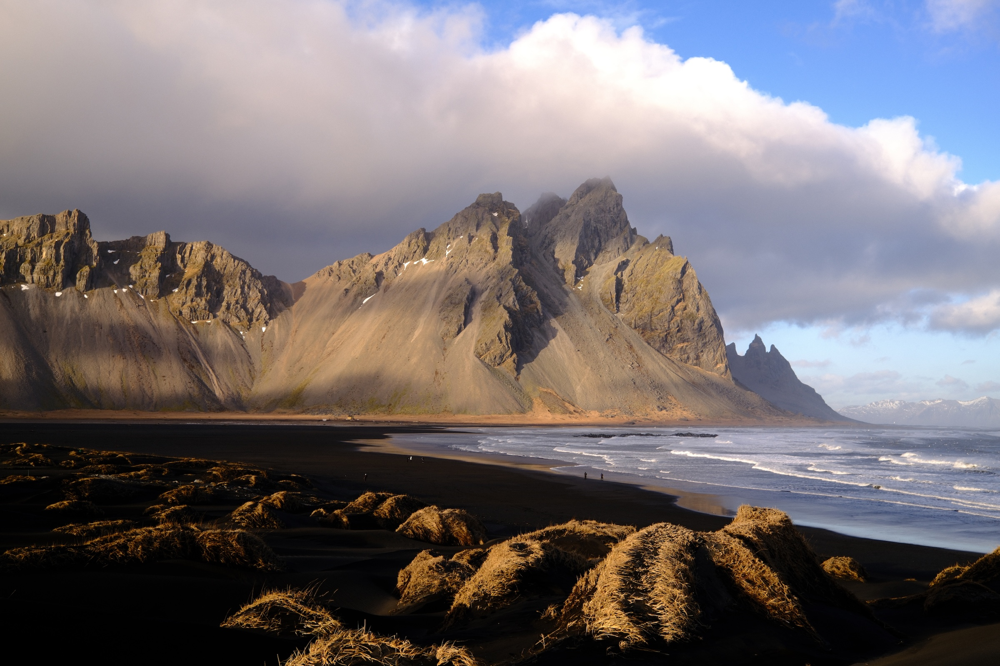

Hello!

I’m about two months into my support-raising season! It’s been a long season already, with plenty of ups and downs, but through it all, God’s faithfulness and sovereignty have been so evident.

This month, I thought I’d share some of the lessons I’ve been learning through Cru’s Institute of Biblical Studies. My GCTC classmates and I have been taking a course called *Introduction to Mission*, which has taught us about God’s mission and the role we, as the Church, play in it.

One of our textbooks is *Perspectives on the World Christian Movement*, by Ralph D. Winter and Steven C. Hawthorne. I’ve really enjoyed reading it (maybe more than any other textbook haha), and my favorite section so far has been Chapter 5, “Mission and God’s Earth,” by Christopher J. H. Wright.

Wright reflects on God’s creation of the world, where God repeatedly declares His creation to be good. As Wright writes, “the earth has *intrinsic* value” because “it is valued by God, who is the source of all value.” All of creation belongs to God and exists for His glory, and we as believers are called to care for it. Furthermore, the gospel is good news for **all** of creation.

> “Creation exists for the praise and glory of its Creator God, and for mutual enjoyment between the Creator and the created.”
> <cite>— Christopher J. H. Wright (p. 28)</cite>

There is so much to think about, but over this past month, I’ve been reflecting on two ideas in particular that I’d love to share: our God as an artistic God, and how the mission field is much wider than I often realize.

## Our artistic God

If you didn’t know, I love nature. My friends know that if you ever ask me about Iceland, you’ll have to fight me to get me to stop showing you pictures of incredible waterfalls, landscapes, and, of course, the Northern Lights. One of the reasons I love nature so much is because it feels like God’s artwork.

Every time I come home to the Bay Area, I make a trip out to the beach, because there’s something so calming about the vast ocean and the steady rhythm of the waves that reminds me of how almighty yet comforting our God is. As God says Himself when He looks upon His creation, it is good.

But reminders of His artistry don’t end with nature. Over this past month, so much of the media I’ve consumed has reminded me of the complexity and creativity of God’s artfulness, qualities we no doubt reflect as people made in His image. Movies and music are full of intricate layers, overarching themes, storylines, and progression. They remind me of how God is often telling a multi-layered story in my life, weaving together different experiences and lessons in ways I might not fully understand until later. I see this even in my current season, which, at a glance, can feel like a season of anticipation and waiting.

Even the Seahawks, funnily enough, remind me of the importance of good design, planning, communication, and leadership. Last year, it was easy for me to draw parallels between game planning for a weekly matchup and preparing for our weekly SOON large group at Northeastern.

And maybe best of all, we are His handiwork, too. One of my favorite places to walk around in Boston is the Museum of Fine Arts. Part of why I love it is that it reminds me that my own life is a work of art, with God as the artist, still shaping me into the person He wants me to be. If an artist can make a masterpiece on a canvas, God can do so much more as He paints the canvas of my life.

Jeremiah 18 paints a picture of God as a potter and His people as clay in His hands:

> "Behold, like the clay in the potter's hand, so are you in my hand, O house of Israel."
> <cite>— Jeremiah 18:6 ESV</cite>

There is comfort and beauty in the idea that God, the potter, is actively shaping us according to His purposes while holding us in His hands. At one point, God gave me new life, making me a new creation. Though that process was painful, He brought me into His family and gave me the hope of eternal life.

This past month has reminded me that creation and the things we create point us back to God. Their beauty encourages me to step back, behold Him, and trust the goodness of the One who is still shaping me.

## A wide mission field

One of the first slides in my Ministry Partner Development (MPD) presentation describes the anxiety, fear, and distraction I've seen among this generation. It's not necessarily that the world is more broken than ever (though maybe it is), but that it's easier than ever to see and hear about its brokenness.

The temptation I often face is to tune it all out and focus only on what I can change, impact, and easily understand. The world is still broken, but narrowing my focus can make it feel a little more manageable.

Even in ministry, it's easy to see the wickedness of the world and become numb to it. Scripture tells us that the world is broken by sin and that the enemy is the “ruler of this world.” Faced with all this brokenness, I can be tempted to distance myself from it, becoming passive rather than choosing to engage.

But Wright’s chapter challenged me to see things differently. God values His creation, from the animals and landscapes to the people who inhabit this world. Reflecting on that truth, I realized how often I overlook people and issues that fall outside my immediate perspective.

At the same time, with the midterm elections approaching, I’ve felt convicted to become better informed and more aware of what’s happening beyond my own circles. Over the past month, I’ve been spending more time learning through daily podcasts and YouTube videos, trying to understand issues and perspectives that I have never really taken the time to think much about or engage with.

As a believer I am called to steward what God has entrusted to me and participate in His mission, and I want to take that responsibility seriously. If God says this world is good, I can’t ignore the suffering and brokenness of the world simply because they make me uncomfortable, and I shouldn’t take for granted the privilege of casting my vote, one of the simplest things I can do.

I have so far to go and much more to learn even on a local level, but I believe God is teaching me the importance of paying attention to the world around me instead of turning a blind eye to it. As I prepare to go on campus in the coming years, it would be irresponsible of me to say I want to change the world while ignoring so much of what is happening within it. My hope is to hold onto this conviction and continue finding ways to participate faithfully in God's mission in the world He loves.

## What's next

Those were two of the many lessons I’ve learned this past month. Maybe they’re things you already knew, but I hope they serve as helpful reminders and encouragements of who God is and what He’s like!

Some exciting things are on the horizon! Next week, I’ll be heading to New York and Boston for a few weeks to visit friends and potentially meet new ministry partners. I’m looking forward to being back after a few months away! If you’re in the area, let me know if you’d be free to meet up!

Something special coming up in December is our **<a href="https://highercallingconference.org/" target="_blank" rel="noopener" aria-label="National Higher Calling Conference (opens in a new tab)">National Higher Calling Conference</a> (HCC)** in Dallas, Texas! Every winter, SOON hosts this really special conference on the East Coast, West Coast, or in Atlanta. This year, for the first time, it’ll be a national conference! HCC is one of the most wonderful events SOON offers, and it’s actually where I found my salvation. I just got permission to serve this year, and I’m super pumped!

I really believe God is going to do something special in the lives of the students who attend. Now, it’s just a matter of getting them there! Please pray for the students who are considering going and that God would make a way for them to attend. If you have or know a college student who might be interested, I’d love to share more information!

I’m excited to share more soon! Please also let me know how I can be praying for you. Thank you for keeping this ministry in your hearts, especially as I continue to raise support and build this team!

## How you can pray

- **My support-raising journey:** That I would keep God at the center of this season, trusting in His strength and provision rather than striving in my own. Pray that God would continue to bring potential ministry partners into my life that I can share His work with.
- **A heart for God's creation:** That God would sustain my conviction to care for His creation through staying informed, loving His people, and taking time to appreciate and enjoy what He has made.
- **My Sabbath:** That I would continue to protect my Sabbath and find true rest in Him. Pray that I would grow in trusting that my ministry does not depend on how much I work, but on God's faithfulness to provide and work through me.
- **National Higher Calling Conference (HCC):** That interested students would receive the financial support and have the means to attend, and that God would already be preparing the hearts of the students who will be there.

